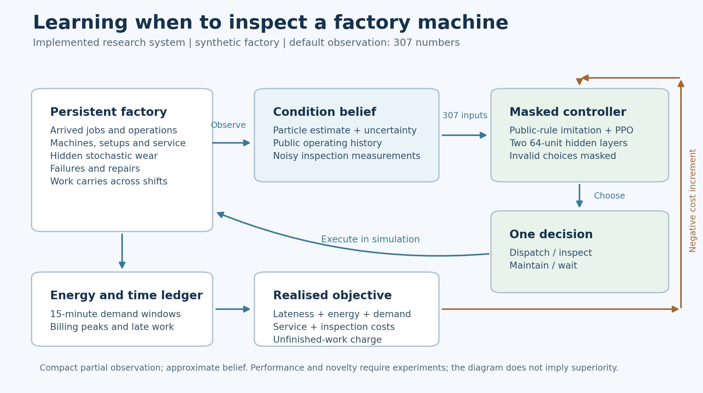

# Adaptive inspection project: verified research status

Updated 2 November 2026. This is the consolidated entry point; individual run
manifests and reports provide the measured evidence.

## Ready models and completed final check

This improvement round is complete: 12 new neural models trained with real CUDA
updates, two independently audited 700-row studies, and a final 200-row fixed-policy
test after 110 common-validation evaluations. All 1,600 new held-out rows have
zero invalid actions and reconciled daily/billing records. The GPU test suite
passes 73 tests; the preserved CPU runtime passes 72 with the CUDA-only test skipped.
No PPT, presentation or demo UI was created or edited.

The final selector compared all six saved standalone neural policies, three CEM
policies and two rules on validation 10240-10249. It locked these choices before
opening test 24900-24949:

- Neural model: [shared-scorer PPO, seed 0, selected at 65,536 steps](residual_dispatch/models/no_prior_s0/model.zip).
- CEM model: [readable learned policy, seed 1](priority_search/policy_s1.json).
- Overall validation winner: retuned setup-aware SPT, recorded with its parameters
  in [selection.json](final_selection/selection.json).

On the final 50 untouched three-day sequences, the fixed selected controllers gave:

|Fixed controller|Mean combined cost|Completion|On-time completion|
|---|---:|---:|---:|
|Selected neural PPO|39.733|98.422%|49.20%|
|Selected CEM policy|34.669|98.867%|61.84%|
|Retuned setup-aware SPT|36.308|98.867%|60.13%|
|Original SPT|37.772|98.511%|60.38%|

Selected neural minus retuned rule is +3.425, paired-scenario 95% interval
[1.875,5.357]; versus selected CEM it is +5.064 [2.769,7.434]. Versus original SPT,
+1.961 [-0.497,4.584] does not establish superiority. This final check does not
support a neural advantage over the strong alternatives. CEM's lower test mean
must not retrospectively replace the recorded overall validation winner.
These intervals describe fixed selected policies over 50 matched scenarios;
they exclude training-seed and model-selection uncertainty. These are normalised
simulation costs, not accuracy percentages, monetary savings or factory validation.

The neural improvement over the older neural control in the first study below
remains valid for that matched experiment; its 18.1% should not be transferred
to this different fixed-policy test. See [the final report](final_selection/report.md),
[locked choices](final_selection/selection.json),
[actual selected-model prediction](final_selection/decision_example.json),
[accounting checks](final_selection/verification.json) and
[independent final review](final_selection/verification_review.json).
All training/evaluation processes have finished; no further training is planned
for this bounded round. The selected GPU-trained model was also replayed
successfully in the preserved original CPU runtime, including its saved action
probabilities. The completed overnight monitor was removed.

## New neural improvement round — both multi-seed studies complete

The user requested additional research-led improvement and GPU training. A new
separate `residual_dispatch/` protocol has completed six models and 700 verified
rows after code review, 71 preflight tests and a 12-row engineering check. The
subsequent event-wrapper tests bring the suite to 73. Original completed results
below remain unchanged. Validation is 10200-10209 and fresh test sequences are
24500-24549; this new test uses three-day episodes and accelerated two-day bills.

The hybrid controller retains an explicit public belief-maintenance/WAIT rule.
A shared neural scorer learns job rankings as bounded adjustments to a strong,
previously validation-retuned setup-aware SPT prior. Its 92 bounded inputs contain
six features per candidate, a prior logit/presence flag and 12 public context
values. The same scorer is applied to each candidate; it is not a graph neural
network. The zero-residual deterministic policy exactly matches the prior.
Stochastic PPO training explores other jobs, so initial stochastic behaviour is
different. A matched no-prior scorer and frozen prior are the critical controls.
This method learns dispatch only; it cannot demonstrate learned inspection or
maintenance, and none of these individual algorithm ideas is new.
The fixed gate suppresses inspection and discretionary waiting while jobs can be
dispatched, so these experiments do not test the full original action space.
The compact observation retains tariff and billing peak but compresses other
machine/metering details; it is not a proof of an exact Markov state or optimal
electricity control.

The design adapts shared learned dispatch scoring from
[Zhang et al., 2020](https://arxiv.org/abs/2010.12367) and the general residual
learning idea from [Johannink et al., 2018](https://arxiv.org/abs/1812.03201).
The latter is robotics research, not evidence for this factory application.
Our implementation is a small shared MLP rather than their graph/robot control
models; its performance must be established by our own comparisons.

|Controller on the same 50 fresh sequences|Mean cost|Completion|On-time completion|
|---|---:|---:|---:|
|Old adaptive neural controller|46.339|97.104%|50.34%|
|New shared neural PPO, no job-priority prior|37.965|98.511%|55.92%|
|Original SPT + belief maintenance|36.816|98.756%|62.89%|
|Frozen retuned setup-aware SPT|33.802|99.067%|60.53%|
|Residual neural policy selected by validation|33.802|99.067%|60.53%|
|Previously learned CEM priority policies|33.850|99.059%|62.02%|

The standalone neural scorer selected real PPO updates [65536,57344,16384] for
seeds 0-2. Its mean cost is about 18.1% lower than the old neural controller on the
same fresh test grid. The additional exploratory paired difference is -8.374,
95% interval [-12.978,-3.363]. This comparison changes the whole architecture,
training protocol and service gate, so it cannot isolate one cause of the gain.

The standalone scorer remains worse than the stronger retuned rule: difference
+4.163, 95% [1.032,7.973]. Versus original SPT the difference is +1.149,
95% [-2.164,5.065], which does not establish superiority. These supplementary
standalone comparisons were computed after the primary study and have unadjusted
exploratory intervals. No claim is based only on the weaker old neural baseline.

All three residual models selected step zero and made zero changes from their
starting rule. Their lower cost than the old neural controller/original SPT comes
from the frozen strong prior; it is **not an added PPO gain**. The bounded residual
also restricts how far choices can depart from large prior-score gaps. All six
models performed 32 actual CUDA update cycles before validation selection.
There are zero invalid actions; all 2,100 daily and 1,400 billing records, objective
formulas, caches, source/control/model hashes and paired intervals reconcile.
Inspection was suppressed by the fixed gate. A validation-selected standalone neural
[decision example](residual_dispatch/decision_example.json) records actual masked
probabilities and prior-plus-residual logits, not causal feature attributions.
See [the complete shared-scorer report](residual_dispatch/report.md),
[artifact verification](residual_dispatch/verification.json) and
[supplementary standalone comparisons](residual_dispatch/paired_standalone_supplement.csv).

The mean normalised lateness component fell from 15.323 for the old neural
controller to 11.102 for the standalone scorer; the unfinished-work component
fell from 5.213 to 2.680. These are arithmetic cost-component differences, not
proof that a particular feature caused the improvement. All components are
exported in [cost_components.csv](residual_dispatch/cost_components.csv).

The optional transfer of the residual models was skipped because all three
selected the unchanged rule; repeating it would add no neural-learning evidence.
No new transfer result should be inferred from this study.

The RTX 4050 Laptop GPU (6 GB) is usable in a separate `.venv-gpu` runtime with
official PyTorch 2.11.0+cu128. The original CPU environment is preserved. Actual
2,048-step PPO throughput measured 631 steps/s on CPU, 410 on full CUDA and 579 with CPU
collection/inference plus CUDA gradient updates. The chosen mixed execution
uses real GPU optimisation with about 9% overhead versus the CPU measurement;
it is not a claim of GPU speedup. Saved metadata records GPU update calls.
The simulator remains on CPU. Existing model reload and dependency checks pass.
See [the measured device comparison](residual_verification/device_benchmark.json).

A further training-only diagnostic found 66.41% of sampled transitions were
single-action states. Grouping consecutive forced actions preserved every
physical action/state, trace, ledger and reward in ten paired training scenarios.
A separately reviewed `event_dispatch` study has completed: it keeps the same
physical simulator, observations, service gate and undiscounted objective, but
lets PPO train at genuine dispatch choices. Physical-action targets are matched
at 65,536; complete-rollout overshoots and discarded final probes are explicitly
counted. GAE still uses lambda 0.98, now per aggregated decision; the learning
estimator therefore changes. It did not establish a scheduling-cost gain.
This grouping follows the established idea of temporal abstraction; see
[Sutton, Precup and Singh, 1999](https://www.sciencedirect.com/science/article/pii/S0004370299000521).
The change in the estimator's time index follows from the exponentially weighted
GAE definition in [Schulman et al., 2015](https://arxiv.org/abs/1506.02438).
The equality of our actual undiscounted physical costs is established by the
project's trajectory tests, not by claiming the paper evaluated this factory.
The [training-only diagnostic](residual_verification/forced_decisions.json) is
efficiency/equivalence evidence, not held-out scheduling superiority.
The full suite now passes 73 tests after the event-wrapper checks. The
event study started after the first run completed, and uses validation 10220-10229
and fresh tests 24700-24749. It compares both event variants with both saved plain
variants and the two rules on the same grid. No GPU training jobs are duplicated.

On these 50 fresh sequences, event no-prior cost was 40.446 versus 40.063 for the
saved plain no-prior models. The paired difference +0.383 had 95% interval
[-2.510,3.629], so there is no demonstrated cost improvement from this protocol.
On-time completion was 59.72% versus 55.19%, while completion was 98.119% versus
98.489%; these descriptive tradeoffs do not overturn the combined-cost finding.
All three event residual policies again retained step zero and exactly reproduced
the retuned rule, at cost 37.106 on this distinct scenario grid. The event no-prior
policies selected outer steps [15360,18432,12800]; those counts must not be
confused with physical-action counts in the plain experiment.

All 700 rows, 2,100 daily records and 1,400 billing entries reconcile, with zero
invalid actions and independently verified source/model/control identities,
checkpoint minima and bootstrap intervals. Completed physical rollout counts
ranged from 65,638 to 66,989, with 102-1,453 recorded overshoot and 4-65 additional
discarded probe actions. The six event models made 39-50 CUDA update calls each.
This is a physical-budget comparison with small disclosed overshoots, not an
exactly identical amount of experience or an isolated GAE-parameter experiment.
See [the event results](event_dispatch/report.md),
[artifact checks](event_dispatch/verification.json) and
[independent review](event_dispatch/verification_review.json).

The final selection stage completed separately as described at the top of this
report. Its four fixed-policy comparisons use scenario uncertainty only, not
the training-seed interpretation of the studies above.

## Original full-cycle evaluation completed — 2 November

The planned 60-day experiment is complete: 15 neural models trained for 65,536
PPO steps each, five training seeds, 500 common held-out sequences (20000-20499),
and exactly 12,500 evaluation rows across nine controllers. All models, caches,
source/configuration hashes and validation selections were checked. There are
zero invalid actions. All 750,000 daily records and 25,000 billing-period records
reconcile with the episode objectives, including inspection downtime and direct
inspection costs. Each sequence covers 60 simulated days and two 30-day bills.

|Controller|Mean combined cost|Completion|On-time completion|Mean inspections|
|---|---:|---:|---:|---:|
|SPT + belief maintenance|652.847|99.929%|60.67%|0.00|
|EDD + belief maintenance|753.584|99.885%|50.90%|0.00|
|Uncertainty-triggered inspection rule|793.175|99.872%|49.51%|13.70|
|Neural controller without inspection|846.824|99.857%|46.68%|0.00|
|Exact-health neural reference (privileged)|849.419|99.855%|45.31%|0.20|
|Periodic inspection rule|922.094|99.851%|46.28%|599.66|
|Adaptive inspection neural controller|965.963|99.807%|44.37%|182.13|
|Imitation-only controller|991.631|99.832%|42.68%|252.51|
|Reactive EDD, no preventive maintenance|1118.387|99.772%|36.30%|0.00|

The original adaptive neural controller did **not** beat the strong rules or its
no-inspection comparator. Adaptive-minus-reference paired cost differences are:

|Reference|Mean difference|95% interval|
|---|---:|---|
|SPT + belief maintenance|+313.117|[277.388, 355.844]|
|EDD + belief maintenance|+212.379|[177.012, 254.820]|
|No-inspection neural controller|+119.139|[86.163, 155.472]|
|Imitation-only controller|-25.667|[-78.741, 0.000]|
|Reactive EDD|-152.424|[-188.549, -109.396]|

Negative differences favour adaptive. Intervals use 2,000 hierarchical bootstrap
draws over training seeds and matched scenarios (fixed RNG seed 702). The SPT
comparison is supplemental, computed after the primary run; it is saved separately.
These are simulation cost units, not money savings or AI accuracy. High completion
must be read alongside substantially lower on-time performance. Exact health
provides privileged information, not an optimal-controller bound.

Validation selected adaptive PPO steps [0, 0, 0, 8192, 0], no-inspection steps
[0, 0, 0, 0, 32768], and exact-health steps [0, 8192, 0, 8192, 0] for seeds 0-4.
Thus 11 of 15 selected policies retained their imitation warm start. Four adaptive
policies exactly match their imitation-only controls; the adaptive-imitation
interval includes zero. This does not establish a reliable added benefit from
PPO. Training agreement is an imitation diagnostic, not scheduling accuracy.

The adaptive condition made 315.95 preventive-maintenance calls and suffered
235.83 breakdowns per sequence on average; SPT made 408.12 calls and suffered
141.06 breakdowns. Empirical coverage of nominal 90% health intervals was 87.19%
for adaptive, 86.56% for imitation, 89.99% without inspection and 89.88% for SPT.
These are correlated simulator diagnostics; no independent-sample binomial
accuracy claim is justified. The adaptive filter's undercoverage remains a limit.

See the [complete original study](full_cycle/report.md),
[independent verification](full_cycle/verification_review.json),
[reproducible artifact checks](full_cycle/verification.json),
[supplemental SPT interval](full_cycle/paired_spt_supplement.csv), and
[paired uncertainty figure](full_cycle/paired_cost_differences.png).
All prior negative results and the separate controller improvements below remain
visible. The original study's planned evaluation/reporting is complete; the
additional neural work has its own status above. Presentation work remains
deferred until requested.

## Current improvement work

The user prioritised substantive project improvement before the review and
explicitly deferred PPT/presentation work. No presentation has been updated.

Two separate controller experiments and their audits have completed; the original
`full_cycle` is also complete and preserved. A smaller zero-shot 60-day transfer
check completed under `priority_transfer/`. Do not mix their protocols or costs.

- `critic_refinement/`: three training seeds, 65,536 PPO steps each in two
  conditions, five validation sequences and 50 new test sequences (21100-21149).
  Both conditions start from identical saved imitation actors and use the same
  reward scaling and controlled PPO settings. Only one receives value-network
  pretraining on its own stochastic training trajectories. Original imitation,
  legacy adaptive and five public rules are evaluated on the same new sequences.
- `priority_search/`: three optimiser seeds, eight cross-entropy generations,
  20 candidate policies and four shared training sequences per generation.
  Five validation sequences select the policy; 50 separate test sequences
  (22300-22349) assess it. The readable score combines duration, setup, slack,
  job age, remaining operations and nominal energy with learned maintenance and
  inspection thresholds. The original SPT rule is an eligible starting policy.

The motivation is specific: the original actor-only imitation leaves the value
network random, rare maintenance actions are poorly imitated despite high
overall agreement, and the EDD teacher does not demonstrate SPT job rankings.
The calibration experiment separates value pretraining from its shared PPO
settings. The readable policy search addresses the dispatch-policy limitation.
These are different interventions and must not be pooled into one causal claim.

Engineering checks include critic-only fitting with bitwise-unchanged actor
logits, terminal-inclusive returns, raw-objective-preserving reward scaling,
matching the starting SPT controller through a full episode, and rejection of
stale controller caches. The final calibration verification completed 18 rows
and priority-search verification completed 14 rows, each with zero invalid
actions and reconciled daily/billing records. These tiny runs establish the
pipeline, not superiority. Both calibration verification actors retained PPO
step zero. The value-fit holdout MSE decreased from 113.27 to 20.16 in that
engineering check; improved value fit alone is not improved scheduling.

Method references: [Kernbach et al., 2026, actor-critic pretraining](https://arxiv.org/abs/2602.23804),
[official SB3 training guidance](https://stable-baselines3.readthedocs.io/en/master/guide/rl_tips.html),
[MaskablePPO update controls](https://sb3-contrib.readthedocs.io/en/master/modules/ppo_mask.html),
[Szita and Lorincz, 2006, cross-entropy policy search](https://doi.org/10.1162/neco.2006.18.12.2936),
and [Ferreira et al., 2021, interpretable dispatch-rule learning](https://arxiv.org/abs/2109.03323).
The implementation adapts established ideas. It does not invent a new PPO
algorithm or establish world-first novelty.

## Verified new controller results — 1 November

Both new primary grids were independently checked for source identity,
duplicate rows, zero invalid actions, daily final objectives and billing costs.
The complete software suite now passes 63 tests.

### PPO calibration: 850 rows, three training seeds, 50 new sequences

|Controller|Mean combined cost|Completion|
|---|---:|---:|
|SPT + belief maintenance|36.904|98.69%|
|EDD + belief maintenance|39.169|98.09%|
|Revised actor-only PPO|44.042|97.30%|
|Revised actor-critic PPO|44.263|97.39%|
|Initial imitation|45.676|97.28%|
|Legacy adaptive model|46.949|97.02%|

All six revised learners selected post-imitation PPO checkpoints (16,384 to
57,344 steps). This establishes that the new training no longer invariably
falls back to imitation. It does not establish superiority to strong rules.
The actor-critic minus legacy cost difference is -2.686, paired 95% interval
[-5.443,-0.190], in this exploratory protocol. The actor-critic minus matched
actor-only difference is +0.221, interval [-1.390,1.886]. There is no established
added benefit from critic pretraining, and its comparison with initial imitation
also crosses zero. Differences from legacy combine all revised training choices.
See [the full calibration report](critic_refinement/report.md).

### Readable policy search: 550 rows, three optimiser seeds, 50 other new sequences

|Controller|Mean combined cost|Completion|Mean inspections|
|---|---:|---:|---:|
|Learned priority policy|35.656|99.07%|0.00|
|Original SPT + belief maintenance|38.183|98.89%|0.00|
|EDD + belief maintenance|41.231|98.16%|0.00|
|Uncertainty-triggered inspection rule|43.849|97.82%|11.46|

The learned-minus-original-SPT difference is -2.527, paired 95% interval
[-4.265,-0.749]. Mean combined cost is about 6.6% lower in this three-day
simulation. The worst 10% episode-cost mean is 53.780 for the learned controllers
and 64.173 for SPT, a descriptive tail statistic rather than another independently
confirmed finding. Belief 90% interval coverage is 90.04% under the learned
controllers; this is empirical condition-interval coverage, not AI accuracy.

All fitted inspection thresholds led to zero inspections. Disabling inspection
therefore changes no decisions or costs. The improvement is scheduling-related;
it does not demonstrate an inspection/information-value advantage. See
[the priority-policy report](priority_search/report.md) and its saved weights.

### Stronger comparator and component audit: 500 supplementary rows

A setup-weighted SPT baseline was selected on validation only from 15 setup and
maintenance parameter combinations. It achieved cost 35.995 and completion
99.22%. Learned minus this stronger rule is -0.338, paired interval
[-1.887,1.389]: no established advantage. The improvement over the original
SPT rule must not be advertised as superiority over all simple scheduling rules.

Fixed-parameter interventions removing energy, urgency/age, or learned service
thresholds did not establish individual component benefits. Keeping the learned
dispatch score but using the original fixed service settings gave a lower point
cost (34.794), with an uncertain difference. These are exploratory interventions
on fitted policies, not separately retrained ablations. The unchanged prior
results and all negative comparisons remain part of the evidence.
See [the supplementary audit](priority_audit/report.md).

### Zero-shot 60-day transfer: 50 rows, ten new sequences

The three saved learned controllers were tested without retraining under the
actual 60-day, 30-day-billing configuration. Two deterministic rules were tested
on the same ten new sequences (23300-23309). Every row has 60 daily records and
two billing periods, with full reconciliation and zero invalid actions.

|Controller|60-day mean combined cost|Completion|On-time completion|Mean inspections|
|---|---:|---:|---:|---:|
|Learned priority policy|592.431|99.946%|60.55%|0.00|
|Original SPT + belief maintenance|665.974|99.933%|59.63%|0.00|
|Validation-retuned setup-aware SPT|597.897|99.956%|58.76%|0.00|

Learned minus original SPT is -73.543, paired 95% interval [-100.594,-46.554],
about 11.0% lower mean combined cost in this exploratory transfer check.
Learned minus retuned setup-aware SPT is -5.466, interval [-25.904,20.637].
The learned improvement over the original rule survives this horizon change;
superiority over the stronger retuned rule remains unestablished. Three-day and
60-day absolute costs must not be compared directly. High completion is not
on-time performance or AI accuracy. All policies still chose zero inspections.

Independent review verified the exact grid, both billing periods, all daily
ledgers, source/checkpoint identities and public-information restrictions.
This is ten transfer sequences, not completion of the separate 500-sequence
original neural study, and it does not establish real-world savings. See
[the full transfer report](priority_transfer/report.md).

## What is implemented

The separate `InspectionEnv` simulates a factory with jobs, alternative machines,
setups, hidden stochastic deterioration, failures, preventive maintenance,
imperfect inspections, and waiting. Machines and unfinished jobs persist across
shifts. Fixed 15-minute demand windows and an accumulated billing ledger persist
across days; a new billing period resets only its peak tracker.

An inspection consumes time, energy and a configured direct cost. It improves
information, not physical health. Ordinary controllers see a particle-based
condition estimate and uncertainty. They do not receive true health, hidden wear
rates, future failure shocks or unreleased job routes/durations.

The primary configuration has 13 actions: ten job shortlist positions,
maintenance, inspection and waiting. Its flat observation has 307 numbers:
17 global values + 10*(7+3) job values + 10*(16+3) machine values. This is a
new schema, distinct from the legacy project's 233 numbers and 11 actions.

The main neural method is MaskablePPO with two 64-unit hidden layers, preceded
by explicitly disclosed imitation of a public rule using training scenarios.
Rare-action weighting attempts to improve service-action learning, but observed
maintenance recall remains poor despite high overall agreement. An imitation-only controller is tested
separately. Validation can retain the pre-PPO checkpoint; reports show zero
selected steps when that happens.

## Verification completed

- 63 meaningful tests pass: the original 56 plus seven controller-refinement tests.
- Gymnasium checking and dependency checks pass.
- Independent review identified and verified fixes for future-order leakage,
  incompatible cache reuse, incomplete seed comparisons and final ledger costs.
- The [final smoke verification](verification/report.md) completed 18 rows:
  two scenario sequences and nine controllers, with zero invalid actions.
- Its final daily objectives match final episode objectives; billing-period
  charges sum to total demand liability.
- This smoke run selected pre-PPO imitation checkpoints for all three neural
  conditions. It does not establish an improvement from PPO.

## Experiments and how to interpret their status

|Directory|Purpose|Evidence boundary|
|---|---|---|
|`verification/`|Final small end-to-end check|Completed; engineering evidence only|
|`mechanism/`|One controlled validation snapshot, 12 cells, 24 matched worlds|Completed; inspection did not beat both alternatives|
|`exploration/`|96 cells varying duration, workload, uncertainty and headroom|Completed; no cell established inspection as better than both alternatives; fresh confirmation was also negative|
|`confirmation/`|Two inspection regimes, five fresh validation scenarios, 128 matched worlds per action|Completed; neither regime established inspection as better than processing|
|`final_pilot/`|Three-day accelerated billing experiment, five training seeds, 50 test sequences|Completed: 1,250 verified rows; no demonstrated adaptive advantage|
|`full_cycle/`|60 days, 30-day billing, five training seeds, 500 test sequences|Completed: 12,500 verified rows; adaptive worse than SPT and no-inspection; 11/15 step-zero checkpoints|
|`critic_refinement/`|Controlled revised PPO, three seeds and 50 new sequences|Completed: 850 rows; critic-specific gain unestablished; weaker than SPT|
|`priority_search/`|Readable policy search, three optimiser seeds and 50 new sequences|Completed: 550 rows; lower cost than original SPT, zero inspections|
|`priority_audit/`|Stronger tuned rule and fixed-parameter interventions|Completed: 500 supplementary rows; no established benefit over tuned rule or from individual added components|
|`priority_transfer/`|Saved priority policies on ten fresh 60-day sequences|Completed: 50 rows; lower cost than original SPT, uncertain difference from tuned rule|
|`pilot/`|Initial scratch-PPO attempt|Exploratory negative result: some seeds learned to wait and abandon work|
|`validated_pilot/`|Intermediate pilot before final accounting/reporting fixes|Stopped and superseded; do not use as primary results|
|`warm_smoke/`|Intermediate warm-start check|Superseded by final verification|

Do not describe an active run as finished. The final reports must include actual
completed seeds, scenario counts, selected training checkpoints, cost components,
completion, service use, failures and uncertainty. A lower cost with worse job
completion is not automatically a better factory controller.

## Completed five-seed pilot

All 15 neural models trained for 65,536 PPO steps each. Nine controllers were
evaluated over 50 common test sequences; neural results additionally span five
training seeds. All 1,250 rows have zero invalid actions and reconciled daily and
billing ledgers. This is a three-day accelerated-billing experiment, not the
60-day primary study.

|Controller|Mean combined cost|Completion|Mean inspection actions|
|---|---:|---:|---:|
|SPT + belief-based maintenance|38.125|98.51%|0.00|
|EDD + belief-based maintenance|40.878|97.80%|0.00|
|Uncertainty-triggered inspection|43.847|97.56%|11.48|
|Exact-health neural reference|45.024|96.84%|0.09|
|Neural controller without inspection|46.278|96.79%|0.00|
|Imitation-only controller|46.730|96.93%|10.99|
|Periodic inspection|47.445|97.04%|30.00|
|Adaptive inspection neural controller|47.683|96.69%|9.17|
|Reactive EDD, no preventive maintenance|49.826|95.69%|0.00|

The adaptive-minus-SPT mean cost difference is +9.558, with a paired hierarchical
95% interval [7.160,12.024]. This additional comparison was computed after the
pilot and is labelled accordingly; it does not support superiority. The adaptive
controller also did not establish a benefit over its imitation-only control.
Four of the five adaptive seeds retained their pre-PPO checkpoint; every seed's
selected step is disclosed in the detailed report.

The adaptive controller used fewer inspections than the fixed-interval rule, but
this alone is not a performance win: its cost effect was uncertain, completion
was lower, and simpler rules performed better. Do not claim equivalence from a
cost interval that crosses zero.

## The research question

> When is it worth paying to inspect a machine before deciding to produce or
> maintain it, when condition is uncertain and production and electricity costs
> carry consequences across shifts?

The narrower interaction to investigate is whether job urgency and inherited
demand-peak headroom change the value of condition information. The first
diagnostic did not establish an inspection advantage; this remains a hypothesis.
It is not acceptable to promise that the proposed policy must outperform rules.

A separate deterministic teaching test checks the standard information-value
calculation: with equal worn/healthy probabilities, process costs [8,0], a
maintenance cost of 1 and an exact inspection costing 0.2, net information value
is +0.3. An uninformative sensor gives -0.2. Adding a work-related charge that
makes maintenance preferable in either condition also gives -0.2. These are
explicit illustrative cost tables, not measured outputs or a new theorem.

The [fresh-scenario confirmation](confirmation/report.md) did not confirm the
favourable exploratory pattern: the fast/low-cost inspection had higher estimated
truncated cost than processing, with positive paired intervals. Default inspection
was also more costly than processing. These are model-regime comparisons, not
full-policy results, but they currently argue against a strong inspection-benefit
claim. The longer held-out policy study must be interpreted independently.

## Closest research and contribution boundaries

|Source|Established idea|Our proposed investigation|
|---|---|---|
|[Zhang et al., 2023](https://www.sciencedirect.com/science/article/pii/S0278612523001607)|Joint maintenance and production RL under partial observability|Paid observation decisions with operation-level dispatch and billing history|
|[Koutas et al., 2024](https://link.springer.com/article/10.1186/s43065-024-00098-9)|RL inspection and maintenance with erroneous observations|Production deadlines, persistent workload and electricity consequences|
|[Komninos and Zarouchas, 2025](https://doi.org/10.1016/j.array.2025.100454)|Maintenance, uncertainty and value-of-information-based data acquisition|Factory scheduling interactions and a cost/measurement-quality regime study|
|[Jiang and Shang, 2026](https://www.sciencedirect.com/science/article/pii/S0957417425046391)|Energy-aware scheduling already combined with PM and transportation|Inspection choices; no claim to invent joint energy/maintenance scheduling|
|[Tariff-aware load shifting, 2026](https://www.mdpi.com/1424-8220/26/6/1858)|PPO electricity scheduling with demand-charge exposure|Operation-level work/inspection/maintenance with multi-shift state|

These are source-backed related-work connections, not a documented claim that
every feature was copied from these papers. A focused search does not prove the
exact combination is world-first or rare. Strong originality wording requires
a closer full-text comparison and a supported experimental finding.

## What the data means

Processing durations are derived from Taillard benchmark families with separated
training, validation and test source groups. Routes, alternative machines,
arrivals, due dates, machine condition, failures and prices are generated by the
simulator. Initial conditions, inspection accuracy and prices are assumptions.
There is no real factory sensor dataset or industrial calibration in this work.

## What the action explanations mean

The branch tool samples hidden condition and future disturbances from the
permitted belief/model and forecasts unreleased jobs using training-duration
priors. Arrived work and its progress remain fixed. Candidate actions share
sampled worlds. Forecast mismatch and Monte Carlo uncertainty are explicit.

It reports truncated simulated cost with a public-rule continuation. It does
not include a fitted residual value and is not a guarantee about the full future.
Privileged hindsight is a separate labelled mode. Neither mode proves a physical
real-world causal effect or reveals the neural network's internal reasoning.

## How to explain the project simply

"We built a simulated factory where the controller must decide whether to run a
job, inspect a machine, maintain it or wait. It does not know the machine's exact
condition. Inspection gives better information but costs time and money.

Our investigation asks when that information is useful, considering job deadlines
and costs across shifts. We compared learned decisions with simple rules and
periodic inspections. In our completed tests, the neural inspection policy did
not beat the strongest simple rule, and we did not establish an inspection
advantage. We then learned a readable job-priority rule using episode cost. It
improved on the original SPT rule in separate exploratory tests, but its difference
from a better-tuned simple rule was uncertain. The algorithms already exist; our
contribution is the implemented formulation, controlled comparisons, readable
controller and honest analysis of where the methods succeed or fail."

## Honest limitations

The environment is an approximate partially observed model, not a proven exact
POMDP state or a calibrated digital twin. Particle uncertainty must be evaluated
by empirical coverage. Long finite horizons still have an end effect. The
inspection economics and billing-history interaction are not yet established
advantages. Initial results must not be turned into invented savings, AI accuracy,
or a claim of a new PPO algorithm. Existing PowerPoint slides have not yet been
updated to contain these new experiments.
